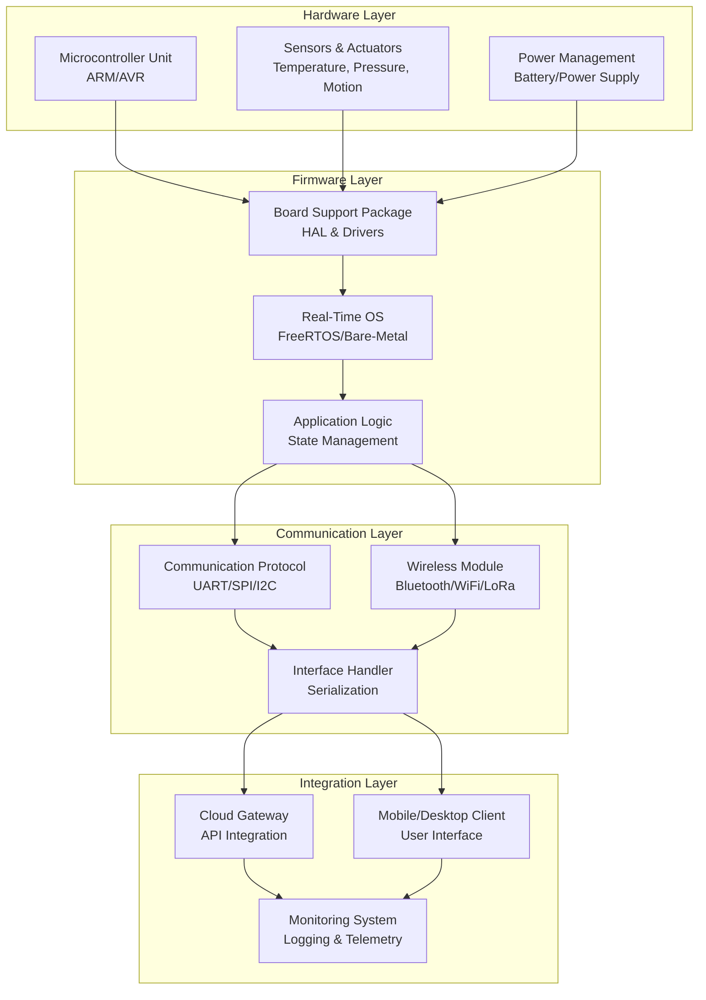
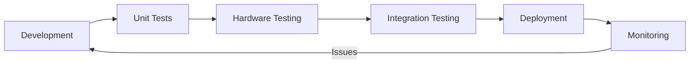

# Solid Rock Hardware - Architecture Overview

This document provides a high-level architectural overview of the Solid Rock Hardware system.

## System Architecture

## Architecture Layers

### 1. Hardware Layer
- **Microcontroller Unit**: Core processing unit (ARM Cortex, AVR, etc.)
- **Sensors & Actuators**: Data collection and control devices
- **Power Management**: Battery and power supply systems

### 2. Firmware Layer
- **Board Support Package (BSP)**: Low-level hardware abstractions and device drivers
- **Real-Time Operating System**: Task scheduling and resource management
- **Application Logic**: Core business logic and state management

### 3. Communication Layer
- **Communication Protocols**: Low-level communication (UART, SPI, I2C)
- **Wireless Module**: Wireless connectivity (Bluetooth, WiFi, LoRa)
- **Interface Handler**: Data serialization and protocol handling

### 4. Integration Layer
- **Cloud Gateway**: Backend connectivity and API integration
- **Mobile/Desktop Client**: User-facing applications
- **Monitoring System**: System health, logging, and telemetry

## Data Flow

1. **Sensor Data** → MCU via BSP drivers
2. **Processing** → Application logic manages state and decisions
3. **Communication** → Data sent via protocols or wireless module
4. **Integration** → Cloud gateway processes and stores data
5. **Visualization** → Mobile/desktop clients display information
6. **Monitoring** → System health tracked through telemetry

## Key Components to Develop

- [ ] BSP and HAL implementations
- [ ] RTOS configuration and task scheduling
- [ ] Sensor/actuator drivers
- [ ] Communication protocol implementations
- [ ] Cloud integration layer
- [ ] Client applications
- [ ] Testing framework and tools
- [ ] Documentation and API specifications

## Development Workflow

---

**Last Updated**: 2026-10-10  
**Repository**: [Solid Rock Hardware](https://github.com/Gkmakendo/solid-rock-hardware)
